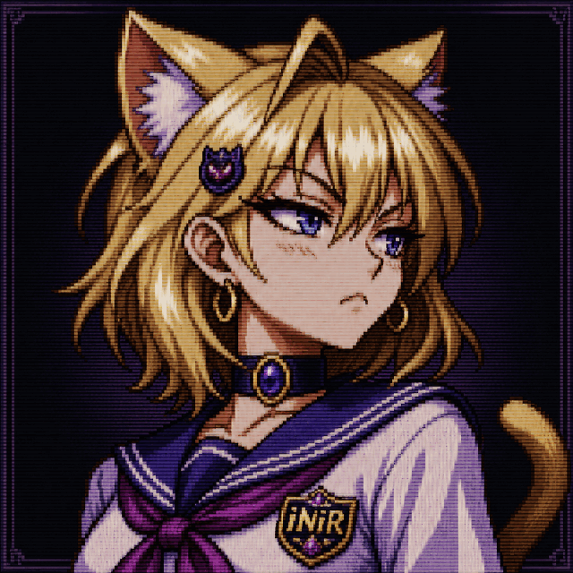

# inir-mascot

Official art pack for **Kira**, the mascot of the [iNiR](https://github.com/snowarch/iNiR) desktop shell.

This repository contains the canonical images and animations distributed to iNiR users. The shell downloads the latest published pack as an optional component.

  

## Repository contents

| Path | Description |
|---|---|
| `inir-mascot-*.png` | Static mascot poses optimized for shell use |
| `inir-mascot-*.gif` | Animated mascot loops |
| `frames/` | Source frames for published animations |
| `CATALOG.md` | Visual index of the complete asset collection |
| `STREET.md` | Classification of the modern street art line |
| `CHANGELOG.md` | Published pack history |

The release archive contains only top-level `inir-mascot-*.png` and `inir-mascot-*.gif` files. Runtime behavior, dialogue, pose selection and settings belong to the iNiR repository and are not part of this art pack.

## Releases

The latest release provides `inir-mascot-pack.tar.gz`, which iNiR installs into its mascot asset directory.

Published filenames are stable and releases are additive. Existing assets are not renamed or removed because multiple iNiR versions may reference them.

## Asset format

New static assets use the shipping format expected by iNiR:

- maximum dimension of 640 pixels;
- indexed PNG with transparency;
- flat top-level filenames using `inir-mascot-<pose>.png`;
- animated assets using `inir-mascot-<animation>.gif`.

Some older published assets are retained for compatibility even when they predate the current optimization rules.

## Branding

Kira is original iNiR product artwork. The assets in this repository are intended for iNiR-related use and are not a general-purpose character pack.
